SmartTaskbar++  
=====

* SmartTaskbar++ is an ultra-lightweight utility that automatically switches the display state of the Windows Taskbar, manages monitor brightness, and applies global screen color effects.

Architecture (v2.0)
------------------

* **Split Daemon Architecture**:
  * **Background Daemon (`SmartTaskbarDaemon.exe`)**: Written in pure C Win32. Sits in your system tray at **~1.5 MB RAM** and **0% CPU** with near-instant startup (< 5 ms). Manages the taskbar auto-hide loop, screen color effects, and quick-toggle icon clicks natively without loading .NET.
  * **On-Demand Settings UI (`SmartTaskbarSettings.exe`)**: Rich C# WinForms companion that launches only when you click *"Settings..."*. Automatically terminates and releases 100% of its memory when closed.
  * **PerMonitorV2 High-DPI**: Razor-sharp rendering on 4K screens with zero bitmap blur.

Features
-----

#### Auto Mode (SmartTaskbar)

* In Auto Mode, SmartTaskbar hides the Taskbar when the focused window intersects with it.
* Automatically ignores detached laptop screens when the lid is closed (clamshell mode).

#### Screen Effects (Integrated from NegativeScreen)
* Click the tray icon to instantly toggle active screen effects.
* Apply global color filters to your display, including:
    * **Negative Mode**: Classic color inversion.
    * **Night Mode (Negative Red)**: Inverted colors with a red filter for eye comfort.
    * **Smart Inversion**: Modern hue-shifting logic that preserves natural colors while inverting brightness.
    * Grayscale, Sepia, and more.

Author
------

* [anmolbyte](https://github.com/anmolbyte)

Credits
----

This application is a combined work of two excellent utilities:

* **SmartTaskbar**: Original taskbar management logic by [ChanpleCai](https://github.com/ChanpleCai/SmartTaskbar).
* **NegativeScreen**: Global screen inversion and color matrix engine by [Melvyn Laïly](https://github.com/mlaily/NegativeScreen).

License
----

This project is licensed under the **GNU General Public License v3.0** (GPL-3.0) due to the integration of NegativeScreen's core logic. 

* The original SmartTaskbar code by ChanpleCai was MIT licensed.
* The NegativeScreen code by Melvyn Laïly is GPL-3.0 licensed.
* As a derivative work, this combined application is distributed under GPL-3.0.

Build
-----
* Google Antigravity and OpenCode
